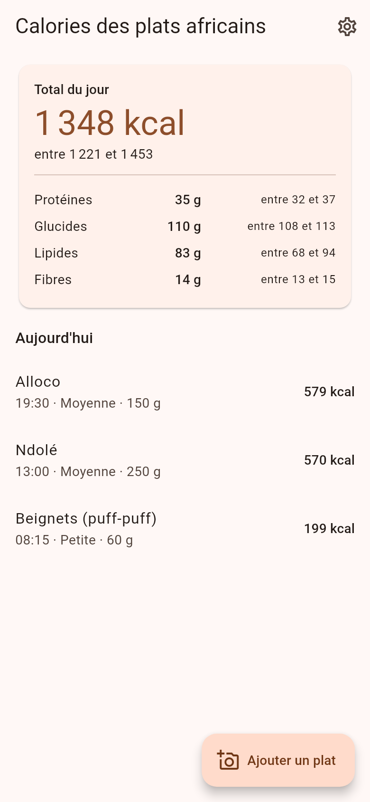
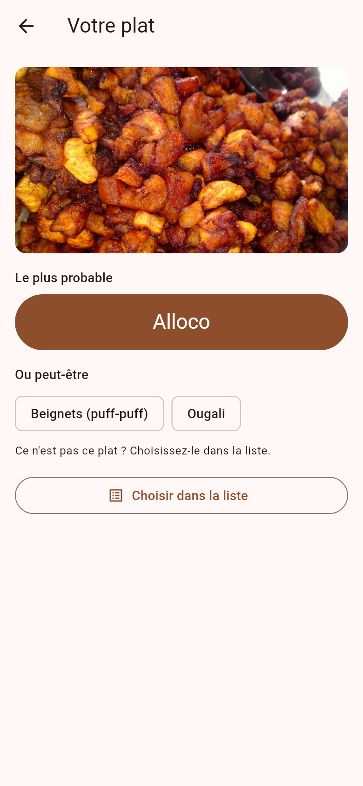
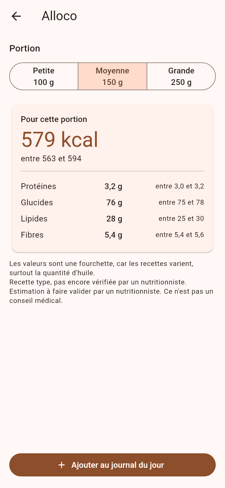
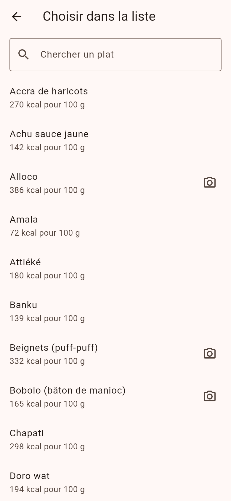
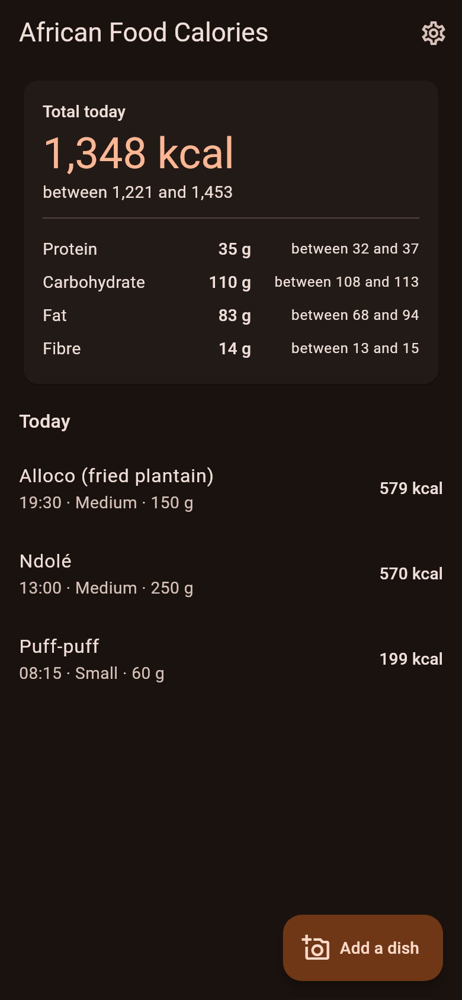

# African Food Calories

[Français](README.fr.md)

An open-source phone app that recognises African dishes from a photo and
estimates their calories, offline. Popular calorie apps do not know ndolé, eru
or waakye; this project starts filling that gap with open data, an open model
and a calorie method anyone can check.

  
  
  
  
  

## What it does

1. Take a photo of your plate, or pick one from the gallery.
2. The app shows the most likely dish with two alternatives, or "dish not
   recognised". You can always pick the dish from the full list instead.
3. Choose the portion: small, medium or large.
4. See the calories and nutrients (protein, carbohydrate, fat, fibre) as a
   **range**, because recipes vary, above all the amount of oil.
5. Keep a journal of the day, with its total.

Everything runs on the phone: no account, no internet connection, and photos
never leave it. English and French, light and dark theme.

## Status: first version

- **44 dishes** can be logged from the list, with calories for each.
- **5 dishes are recognised on photos** for now: alloco, bobolo, fufu,
  puff-puff and ugali. The others need more openly licensed photos.
- On the test set, the model names the right dish for 77 % of photos of these
  five dishes, refuses 20 % ("dish not recognised") and names the wrong dish
  for 3 %. It wrongly names a dish for 12 % of photos of other foods. These
  test photos come from the same sources as the training photos; accuracy on
  everyday phone photos has not been measured yet. Details:
  [model card](docs/model-card.md).
- The portion is chosen by the user. Estimating it from the photo is a
  research problem and not part of this version.
- **Calorie values are estimates to be validated by a nutritionist. This is
  not medical advice.**

## Install (Android 8.0 or later)

Download `app-release.apk` from the latest
[release](https://github.com/Backaad/african-food-calories/releases), open it on
the phone and allow installing from this source. It is a test build, not a
Play Store release. iPhone builds are not available yet.

## How it works

**Recognition.** A MobileNetV3-Large model (transfer learning, distilled from an
EfficientNetV2-S teacher), exported to TensorFlow Lite with float16 weights
(6 MB). It also learnt a class "other" from photos of other foods, so it can say
it does not know. A dish is shown only if its probability reaches a threshold
chosen on validation data. Training runs in a Jupyter notebook on Kaggle or
Colab: [`training/`](training/README.md).

**Calories.** Each dish has a standard recipe (grams of each ingredient per
100 g of dish), with low and high amounts for ingredients that vary. Ingredient
values come from the FAO/INFOODS West Africa food composition table (WAFCT 2019).
A script computes energy and nutrients per 100 g and for three portion sizes:
[method](docs/nutrition-method.md), [`nutrition/`](nutrition/README.md).

**Data.** Only images whose licence was checked one by one: Wikimedia Commons
(CC0, public domain, CC BY, CC BY-SA), plus CamerFood10 for training only. The
repository contains no image, only the scripts that download them and the list
of sources: [data inventory](docs/data-inventory.md),
[`data/sources.yaml`](data/sources.yaml).

The model and the description of the data are also on Hugging Face:
[backaad/african-food-calories](https://huggingface.co/backaad/african-food-calories)
and [backaad/african-food-calories-data](https://huggingface.co/datasets/backaad/african-food-calories-data).

## Repository

| Folder | Content |
|---|---|
| [`data/`](data/) | Sources and licences, dish list, download and inventory scripts |
| [`nutrition/`](nutrition/) | Standard recipes, WAFCT extract, calculation, `dishes.json` |
| [`training/`](training/) | Notebook and scripts: data preparation, training, evaluation, TFLite export; results of each run |
| [`app/`](app/) | Flutter app and its tests |
| [`docs/`](docs/) | Model card, nutrition method, data inventory, screenshots, project brief |
| [`hub/`](hub/publish.py) | Publication on Hugging Face |

Each folder's README explains how to run it. GitHub Actions run the tests of
each part and build the Android app.

## Licences and credits

- **Code**: [MIT](LICENSE).
- **Model** (`training/results/*/model.tflite`, `app/assets/model.tflite`):
  **CC BY-NC 4.0**, non-commercial, because it was trained partly on
  CamerFood10, whose image copyright is not cleared (training only, never
  redistributed; see [`data/sources.yaml`](data/sources.yaml)). The app, which
  contains the model, may therefore only be distributed for non-commercial use.
- **Nutrition values**: computed from the *FAO/INFOODS Food Composition Table for
  Western Africa (2019)*, © FAO 2020, used for a non-commercial product with
  acknowledgement of FAO as source and copyright holder; FAO does not endorse
  this project. Full citation in [`nutrition/dishes.json`](nutrition/dishes.json).
- **Images used for training**: authors and licences of every Wikimedia Commons
  photo are listed in `training/results/*/ATTRIBUTION.csv`. CamerFood10:
  Baban A Erep & Chaari, 2024.
- **Screenshots**: `docs/screenshots/2-result-fr.png` contains a CC BY-SA 4.0
  photo; credits in [`docs/screenshots/CREDITS.md`](docs/screenshots/CREDITS.md).

## Contributing

Recipes checked by people who cook these dishes, openly licensed photos of
dishes that are not recognised yet, a nutritionist's review, translations:
see [CONTRIBUTING.md](CONTRIBUTING.md).
